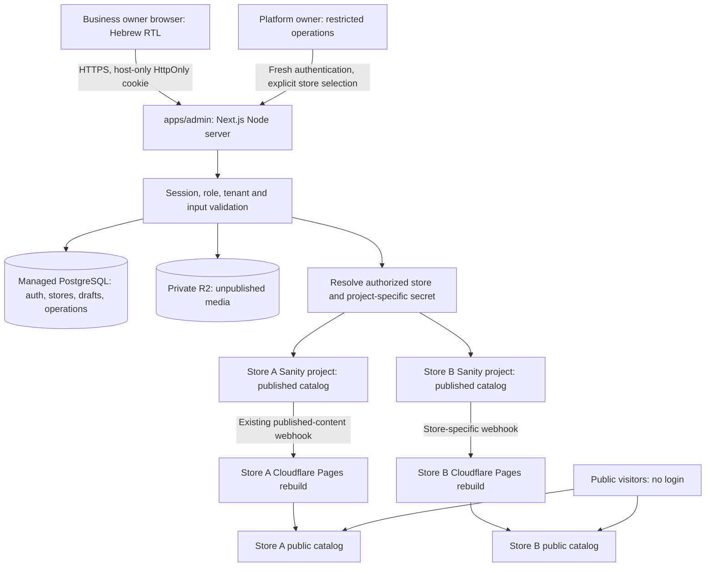

# ATELIER administration platform — Phase A

Superseded for the immediate single-store MVP by [ADMIN_MVP_PLAN.md](ADMIN_MVP_PLAN.md). The user explicitly deferred multi-tenant SaaS architecture and requested zero additional recurring cost. The proposal below is retained as historical planning, not an implementation directive. Its private-media requirement must not be confused with Sanity native draft-document access: native `drafts.*` documents already require authentication in a public dataset.

Date: 2026-10-14. Status: production architecture proposal, not approved. The user approved Phase B only: local mock UI. Hosting vendors, costs, tenant strategy and private workspace/storage choices must be revisited before Phase C, with affordability and operational simplicity as core requirements. No production implementation or provisioning is authorized by this document.

## Recommendation

Add one shared, private `apps/admin` Next.js application with a Node.js server runtime. Use Better Auth for username/password authentication, managed PostgreSQL for accounts, sessions, tenant registry and private drafts, and private Cloudflare R2 storage for unpublished uploads. Keep **one Sanity project and one Git-backed Cloudflare Pages storefront per business**. Sanity remains the source of truth for published catalog content; PostgreSQL holds the private editing workspace.

The private draft workspace is necessary because the existing Sanity dataset is public and ordinary Sanity dataset assets are public even in a private dataset. New draft text and images must not leak through public content APIs or asset URLs. This introduces a small, explicit draft-to-published adapter, rather than changing the approved storefront or its publishing pipeline.

All provider choices and costs below are proposals. Phase A changed only this document. Phase B was subsequently approved as a separate local mock UI effort; that approval does not approve this production architecture. Before Phase C, reconsider the need for separate projects, private draft workspaces, private buckets and paid hosting against affordable boutique subscriptions and operational simplicity. Creating paid resources, production accounts, credentials, or deploying later phases requires the corresponding approval.

## Repository and live inspection

| Finding | Evidence and implication |
| --- | --- |
| Personal repository and identity | Remote is `git@github-personal:hadar-matana/fashion-catalog-demo.git`; local identity is `hadar-matana` / `hadarmat@gmail.com`. Working tree was clean before this document. No GitHub operations were performed. |
| Existing applications | pnpm workspace includes `apps/*` and `packages/*`; storefront uses Next.js 16, React 19, TypeScript, Tailwind and Sanity client. Studio uses Sanity 6. No admin application or authentication service exists. |
| Static public website | `apps/storefront/next.config.ts` sets `output: "export"`. Its protected APIs cannot host this admin service. Keep its webpack build and output directory unchanged. |
| Sanity identity | Studio and storefront both target project `3ahm0828`, dataset `production`, API version `2025-02-19`. Read-only `sanity dataset list` confirms `production`. |
| Public dataset | A successful unauthenticated aggregate query returned 12 published products, 5 categories and 10 gallery documents with product references. Public published data is therefore verified, not assumed. Billing plan, effective token grants and draft inventory were not inspected. |
| Existing product model | `product` has `name`, `slug`, ordered `images`, required category, integer `priceAgorot`, `currency`, description, optional sizes/colors, collections, featured/isNew and sortOrder. Preserve existing IDs, references, image keys, image crop/hotspot metadata and slugs. |
| Existing references | `galleryImage.product` is a strong reference in the schema. Product removal must account for this. `GalleryClient` already guards missing linked-product slugs. |
| Public read behavior | `src/lib/sanity.ts` uses `perspective: "published"`, no token and no API CDN. Static pages are generated from published product slugs. |
| Publishing evidence | `docs/QA_UX_AUDIT.md`, remediation dated 2026-10-13, records verified create/update/delete rebuilds through `cloudflare-pages-publish`, excluding drafts and versions. This is historical repository evidence; Phase A did not modify or re-test the webhook. |
| Existing documentation | `DEPLOYMENT.md` describes the static build and hook. `NEW_CLIENT_SETUP.md` already recommends separate projects per business. Its owner Sanity invitation and `ADMIN_GUIDE.md` Studio instructions will be replaced at handoff, not used for the new owner workflow. The older unchecked launch checklist is not treated as current verification. |

## Architecture and trust boundaries

Only the admin server talks to PostgreSQL, Sanity mutations and storage credentials. The browser receives safe view models and opaque admin identifiers. The public storefront has no admin navigation and no authenticated routes. Internal Studio remains available only to platform operators.

### Tenant strategy and alternatives

| Strategy | Assessment |
| --- | --- |
| Shared public dataset with `storeId` | Reject. Public queries bypass owner authorization; a missed filter exposes other tenants. A shared write credential expands the impact of routing mistakes. |
| Separate datasets in one project | Better separation, but project-level credential grants and dataset quotas require careful verification. Extra datasets and custom access controls are plan-dependent. Not the initial recommendation. |
| Separate private Sanity projects | Viable alternative: native draft text isolation, but still requires private media staging, paid private datasets and server-only storefront build tokens. Would change ATELIER's current production configuration. |
| Separate public Sanity projects + private admin drafts | Recommended. Keeps current ATELIER reads and webhook intact, isolates published mutations per project, and keeps new drafts/uploads outside public Sanity. Uses shared PostgreSQL already required for auth. |

Published catalog content and previously published image URLs are intentionally public: any visitor can view them. The isolation guarantee applies to authenticated management, drafts, new unpublished assets and private identifiers/configuration. It cannot prevent an owner from browsing another business's public website. Unpublishing removes catalog visibility after rebuilding; it cannot retract screenshots, old static preview deployments or already distributed CDN images.

Sanity confirms that [dataset assets remain public regardless of dataset visibility](https://www.sanity.io/docs/content-lake/manage-assets). Its enterprise Media Library supports a different privacy model, but would add cost and migration work. Private datasets currently require a paid plan; a trial/downgrade can make them public. See [plans and payments](https://www.sanity.io/docs/platform-management/plans-and-payments).

Each store registry entry maps exactly one Sanity project/dataset and public deployment. Enforce uniqueness for that pair. Select it from authenticated membership, never request-supplied project IDs, dataset names or tokens. Per-store credentials must have no rights to another project. Use the least privileged available content-write grant, verify its actual scope in staging, and do not depend on custom document-level roles being available on Free. Even a broad content token is held only by the server, behind field/type allowlists; business owners never receive it.

The shared server, database and storage account remain a platform-wide trust boundary. Project separation limits Sanity credential compromise, but does not make a compromised platform server harmless. Keep backups, secrets, operator access and audit logs protected.

## Authentication and authorization

Use self-hosted Better Auth in the admin server with its PostgreSQL adapter and [username plugin](https://better-auth.com/docs/plugins/username). It supports username login on its email/password authenticator; a verified owner contact email is collected during private provisioning, not required on the login form. Use the library's [scrypt password hashing](https://better-auth.com/docs/authentication/email-password), not custom password cryptography. Pin a supported release and confirm compatibility with this repository's Node/Next versions in Phase C.

- Disable public sign-up server-side. Deny unused username-availability, user deletion, email login, role/membership changes and reset-request endpoints unless explicitly part of the approved flow. Audit the entire generated auth route surface, not just the custom login page.
- Normalize unique usernames consistently; use generic Hebrew errors for unknown user and wrong password, with comparable failure work/timing. Login form includes required validation, password visibility, loading and keyboard focus.
- Production cookies are Secure, HttpOnly, SameSite=Lax, host-only, with no cross-subdomain sharing. Sessions live in PostgreSQL; disable cookie session caching so revoked accounts lose access immediately. Proposed expiry: eight-hour absolute maximum with refresh disabled, plus a server-enforced one-hour idle timeout. Require reauthentication within five minutes for provisioning, resets and platform store selection. These are explicit policies to implement, not Better Auth defaults. See [session management](https://better-auth.com/docs/concepts/session-management).
- Keep Better Auth origin/CSRF checks enabled with exact trusted admin origins. For custom mutations require same-origin POST/PATCH, session-bound CSRF token, Fetch Metadata checks and schema validation. Reject missing/mismatched browser origin; no mutations via GET. SameSite alone is insufficient. See [security documentation](https://better-auth.com/docs/reference/security).
- Use shared database-backed atomic rate counters for login, reset and upload endpoints, not per-process memory. Initial login policy: five failed attempts per normalized username per 15 minutes plus an IP limit; use temporary backoff and review denial-of-service tradeoffs. Trust only the hosting provider's verified client-IP header. See [rate-limit storage](https://better-auth.com/docs/concepts/rate-limit).
- Every protected page, API, server action and media read independently validates session, active account, role and active store. Route redirects improve UX but do not enforce API security.
- One active owner per store, enforced with a unique database constraint. Role and membership are server-controlled. No team invitations or employee administration.
- Owners only call product/category/media endpoints. All operations on settings, accounts, integrations, branding and domains require platform role. Return a uniform not-found response for unknown and foreign resources.
- Platform owner uses a restricted workflow initially: explicit store selection with fresh authentication and an audit record. No implicit impersonation or wildcard store access in owner APIs. Require MFA for platform-owner browser operations before production; owner MFA can be optional later.

### Private account provisioning and password resets

Provide an operator-only CLI, run with explicitly authorized environment access, rather than a large super-admin dashboard. It creates/activates store mappings and provisions exactly one owner through the authentication library's server APIs. The CLI must accept sensitive input through a secure prompt, not command arguments or logs.

After verifying the owner's identity through an established contact channel, the operator issues a cryptographically random, single-use setup/reset link, valid for 30 minutes, tied to user and purpose. Persist only its digest in the private database. Transfer the link through an approved private channel; sending messages is a separate authorized action. The link page collects the owner's chosen password and uses library hashing. Redemption and invalidation are atomic. Strip the token from the URL after exchange, set no-store/no-referrer, exclude third-party scripts, revoke prior sessions on reset and audit without secrets. Never store a plaintext or emailed reusable password. Operator MFA/fresh authentication, rate limiting and tests apply to issuing links. No paid email service is required for the first operator-controlled delivery process.

## Data model

| Private PostgreSQL entity | Responsibility |
| --- | --- |
| Better Auth user/account/session/verification tables | Library-managed credentials and sessions; username unique; no password content in Sanity. |
| `store` | ID, display name, active state, Sanity project/dataset, public base URL, Pages project identity and secret reference. Sensitive integration settings are platform-only. No deploy-hook URL needed by the browser or admin publishing code. |
| `store_owner` | Unique store ID and unique owner user ID, foreign keys; one owner/one store for v1. Platform role is separate. |
| `product_workspace` | Composite tenant/resource key, opaque admin ID, stable Sanity ID/slug when assigned, canonical draft payload, workspace version, base published `_rev`, timestamps. Content exists here for unpublished products. |
| `media` | Tenant, opaque media ID, private object key, validated type/dimensions/bytes, upload state and optional published Sanity asset mapping. No arbitrary client asset URLs. |
| `slug_reservation` | Unique `(store_id, slug)` and associated product; serialize first publication and reuse existing slugs. |
| `operation` | Tenant, user, idempotency key, action, expected versions, progress/error and result; prevents duplicate publication and supports recovery. |
| `audit_event` / `reset_grant` / rate counters | Actor/action/resource outcomes, hashed setup/reset grants and distributed abuse controls. No passwords, token URLs or secret values. |

Every private content query uses the verified tenant and composite keys. Add PostgreSQL row-level security as defense in depth for workspace/media/operation tables: use a non-owner application role and transaction-local tenant context; the app role must not bypass RLS. Do not carry tenant context between pooled connections. Auth/global registry access is a separate narrowly scoped repository; platform operations use a separate privileged path.

Sanity schemas remain authoritative for published content. Reuse their shapes and extract pure price/slug helpers into a small shared package only when implementing, avoiding imports from Studio's form components. The workspace adapter represents an image as an opaque media handle or an authorized existing image, then produces existing Sanity image/reference objects at publication. Preserve fields not editable by owners through server-side read/patch, including collections, flags, currency and image metadata; reject client attempts to set them.

Existing Sanity native drafts are not migrated in Phase A. Phase D inventories them server-side and presents any applicable draft once per product, retaining source copies until verified. New admin drafts live in PostgreSQL. Studio remains an internal tool; concurrent edits from Studio trigger revision conflict handling rather than silently overwriting drafts. Do not place private R2 keys inside public Sanity documents.

## Admin-to-content integration and product lifecycle

The content service receives a verified `TenantContext`, not a raw store ID. It uses `server-only` modules, secret-backed per-project clients, parameterized GROQ and Zod schemas. Never accept arbitrary GROQ, mutation objects or document types from clients. List pagination uses stable cursors; search, publication filters and category filters merge private workspaces with published documents without counting the same product twice. Return only the current tenant's safe view model.

The API converts validated decimal shekel strings to integer agorot without floating-point multiplication. Publish requires name, price, valid category and at least one successfully validated image; sizes/colors are optional. Draft saves allow incomplete forms. Limit strings, array lengths and image count server-side. Product `currency` stays ILS. Reuse Hebrew transliteration from `apps/studio/lib/slug.ts`; preserve every existing slug on rename. New slugs include a stable random product suffix plus a unique tenant reservation, with a Sanity collision check. Staging tests must cover concurrent creates and Studio-created collisions.

| User action | Server behavior | Public effect |
| --- | --- | --- |
| New product / save draft | Persist private workspace and private media only. No Sanity product/asset write. | None; no rebuild. |
| Preview | Render current unsaved form state inside authenticated admin; serve private images through authorized media endpoints. | None; no deployment or public URL. |
| Publish draft | Validate, resolve media into the authorized Sanity project, write the published product using its stable identity, record operation result. | Existing published-content webhook requests rebuild. |
| Edit published product | Keep changes in memory until `שמירת שינויים`. Preview shares that same state. | None while typing. |
| Save published changes | Validate and patch published document with `_rev` precondition. Preserve fields outside owner control. | Existing webhook rebuilds; no extra Publish click. |
| Unpublish from editor | Confirm `האם להסיר את המוצר מהאתר?`; retain complete private workspace, safely handle inbound references, remove only published representation. | Existing deletion webhook rebuilds; catalog removal is delayed until deployment. |
| Republish | Publish saved workspace with the original product ID and slug; restore eligible links safely. | Existing webhook rebuilds. |

There is no permanent-delete owner endpoint and no unpublish action in product rows. After saving show `השינויים נשמרו` and explain that the site may take a few minutes to update. Do not claim a deployment has started solely because Sanity accepted a mutation. `האתר מתעדכן` means waiting for the publish pipeline, not verified completion. Only show `העדכון זמין באתר` after a server-side check confirms the expected public content; v1 can omit this message entirely. Read-only deployment monitoring can be added later with separate scoped credentials; never call the deploy hook from admin.

### Safe unpublishing with gallery references

Inventory inbound references before removal. The ten observed gallery product links make this a real compatibility issue. Proposed implementation preserves those references but makes supported gallery-product links weak in the same Sanity transaction as published-product removal; keep the referenced ID so republishing restores the link. Match their current revisions and preserve all other fields. Do not detach gallery images, remove gallery documents or weaken arbitrary references.

Test native Studio behavior and existing gallery rendering first. Unknown reference types must block unpublishing with a helpful message and an operator escalation. If a schema adjustment to `galleryImage.product` is needed for consistent Studio behavior, treat that as a small, reviewed Phase D change with backup and regression tests. This is not authorized production migration in Phase A. [Sanity reference semantics](https://www.sanity.io/docs/studio/reference-type) explain strong/weak references.

### Consistency, recovery and conflicts

PostgreSQL, R2 and Sanity do not share a transaction. Before publishing/unpublishing persist the complete workspace and an idempotent operation. Lock/serialize product mutations per tenant, capture Sanity `_rev`, and perform the Sanity document transaction with revision checks. Repeated requests reuse the same operation key; an interrupted operation reconciles against Sanity before retrying. If Sanity succeeds but final database bookkeeping fails, recover the receipt from live content and do not duplicate publication. Preserve the workspace on failure. Return conflict feedback rather than last-write-wins data loss. No global background publishing service is needed initially, but bounded resumable operations are required.

Category management reads published categories and counts both published and draft product assignments, deduplicated by identity. Add, rename and reorder use validated published category mutations and the existing webhook. Preserve category IDs/slugs/cover fields. No deletion UI in v1; this satisfies the safe-reference requirement without a reassignment workflow. Reorder in one transaction where feasible.

## Media privacy and upload handling

Use one private R2 bucket per store with bucket-scoped server credentials, plus database tenant checks. Keep public access disabled; keys are generated on the server. Upload an authenticated intent first, then permit a short-lived signed PUT for its exact key and approved origin. Enforce maximum size and actual decoded content during finalization, not only a claimed MIME type or client validation; never serve unvalidated bytes.

Initial limits: ten images per product and 10 MB per file, JPEG/PNG/WebP. Decode and re-encode, strip EXIF/location metadata, bound dimensions/pixel count and reject SVG or unsupported formats. HEIC needs a verified conversion implementation; until supported, show clear Hebrew export guidance. Upload limits/processing must be tested against the hosting provider's request limits. Direct private storage upload avoids routing large request bodies through serverless functions; image processing remains server-side and bounded.

Immediate client thumbnails use temporary object URLs. Finalized image reads use session-checked admin media endpoints, with private no-store responses, not public bucket URLs. New R2 media reaches Sanity CDN only after an explicit publish/save-published action. This can expose an asset before the final product mutation completes; a failed publication can leave an orphan public image. Never promise transactional image secrecy after a publication attempt. Private source copies remain for recovery; unreferenced abandoned uploads can expire after a documented grace period, while saved drafts are retained. Lifecycle cleanup must not delete referenced media.

New unpublished images remain private; previously published Sanity images and existing Studio uploads cannot be made private retroactively. Existing dataset asset URLs and static deployment snapshots may persist after unpublish. A requirement to revoke all previously published media would require a separately approved storefront/media architecture change.

## UI and preview design contract

Follow the supplied mobile and desktop images: ivory surfaces, black primary actions, restrained borders and taupe accents, ATELIER wordmark, Hebrew typography and RTL. Desktop has a right sidebar; mobile uses compact navigation, comfortable rows and sticky form actions. Navigation is dashboard, `המוצרים שלי`, `הוספת מוצר`, `קטגוריות` and logout only. Exclude settings, orders, customers, analytics, cart and wishlist.

Images are the first form section. Multiple file selection, desktop drop, accessible reorder controls, removal, main-image indicator, progress and Hebrew errors precede basic name/price/category inputs. Optional description/sizes/colors follow. Add unsaved-leave warnings, disabled double-submit actions and recoverable errors. Product list uses compact rows, search/status/category filters and pagination, not a grid.

Preview is a local admin modal/view based on current form state, with catalog-card and full-product tabs and `חזרה לעריכה`. Use a faithful equivalent of existing presentation initially; extract pure display components only if reuse avoids coupling the storefront to admin auth or Sanity credentials. Reproduce contact-oriented catalog behavior; decorative checkout in mockups is excluded. Do not persist preview data in localStorage, query strings, public URLs or analytics. Authenticated pages and APIs use no-store, no indexing, no third-party analytics and restricted referrer policy; robots rules are not access control.

## Hosting, operations and expected costs

Deploy `apps/admin` independently on Vercel's Node runtime; do not set static export. Use managed Neon PostgreSQL with connection pooling and migrations. Vercel is recommended for straightforward Next.js/Node compatibility, including password hashing and image tooling. Cloudflare Workers/OpenNext is an alternative but needs adapter, runtime and auth/image-library compatibility testing; avoid adding that uncertainty to the first release. Keep storefronts on Git-backed Cloudflare Pages and Studio on its existing host. No new Direct Upload Pages project.

Production, staging and development use separate databases, secrets and private buckets. Staging integration uses two disposable Sanity projects and storefront targets. Preview deployments must not have production content-write credentials. Restrict internal deployment access, backups and operator access. Rotate credentials, test backup restoration, and document store onboarding/offboarding. Store-specific secrets resolve through secret references held server-side; never `NEXT_PUBLIC_*`, returned config objects, logs or repository files. No global Git configuration or work-account credentials change.

Estimates checked against official provider pages on 2026-10-14; USD/month before tax, excluding domains, support labor, backup extras and usage overages. Account eligibility, actual existing billing and quotas must be checked before provisioning.

| Component | Proposed initial allowance |
| --- | --- |
| Admin runtime | Vercel Pro base $20/month, one operator seat; extra usage/seats may cost more. Hobby is restricted to non-commercial personal use. [Pricing](https://vercel.com/pricing), [Hobby terms](https://vercel.com/docs/plans/hobby). |
| Auth library | Self-hosted Better Auth; no managed-auth subscription proposed. Maintenance and security updates remain our responsibility. |
| Shared PostgreSQL | Neon Free for development; budget about $15/month for low intermittent production use on Launch. Usage-based, not a flat $15 guarantee; always-on compute may cost more. [Neon pricing](https://neon.com/pricing). |
| Private draft media | R2 Standard includes 10 GB-month, 1M Class A and 10M Class B requests monthly; above allowance, storage $0.015/GB-month plus operations. Budget $0–$5 initially, excluding admin proxy compute/transfer. [R2 pricing](https://developers.cloudflare.com/r2/pricing/). |
| Per-store published Sanity | Free $0 within quotas, public-only datasets; Growth $15/seat/month if a store needs paid features. Owners need no Sanity seat. Verify project eligibility and operator billing. [Sanity pricing](https://www.sanity.io/pricing). |
| Per-store static storefront | Existing Pages hosting; potentially $0 within account limits. Free plan has 500 builds/month and one concurrent build; monitor aggregate publishing across stores. [Pages limits](https://developers.cloudflare.com/pages/platform/limits/). |

Planning envelope: roughly **$35–$40/month shared base for a small commercial pilot**, plus per-store paid Sanity features and usage where needed. Ten low-volume stores can share that base, but the estimate does not guarantee ten stores fit every free quota. Dataset/project separation creates per-store secret rotation, hook setup and deployment maintenance costs. Track project count, build backlog, draft storage and database usage before scaling. Do not create subscriptions or change billing now.

## Security and production risks

| Risk | Mitigation and release evidence |
| --- | --- |
| Cross-tenant identifier tampering | Session-derived context, per-project tokens, bucket isolation, composite keys/RLS and two-store negative tests across reads/writes/media/categories. |
| Credential stuffing or enumeration | Uniform errors, shared atomic rate limits, hashing, no public registration/availability routes, operator-controlled resets. |
| CSRF, XSS or session theft | Host-only secure cookies, CSRF/origin enforcement on every mutation, CSP, React escaping, plain-text descriptions and no-store responses. |
| Draft or media leak | Private workspace and staging buckets; test unauthenticated API/object requests; no drafts in public Sanity. Explain limitations of already-public assets. |
| Owner edits settings through raw requests | Server type/field allowlists and role checks; test forged roles, store IDs, siteSettings mutations and auth account APIs. |
| Concurrent Studio/admin edits | `_rev` preconditions, stable identity/slugs and explicit conflict handling. No overwrite of hidden fields. |
| Unpublish fails or loses links | Backup workspace before mutation; inbound-reference inventory, reviewed weak-reference transaction and gallery regressions. |
| Publish succeeded, site still old | Existing hook only; truthful delayed-update message; test failure/backlog and do not promise immediate availability. |
| Production storefront regression | No Phase A production change; later scoped commits, two-store staging lifecycle, existing checks, backup/export and reviewed rollback. |
| Shared platform compromise or outage | Least privilege, protected secrets, MFA for operators, isolated environments, monitoring and restore tests. Public static storefront keeps serving during admin outage. |

## Milestones and acceptance gates

1. **Phase A (this delivery):** architecture, live public dataset inspection, cost/risks and approval decisions. No code implementation, production writes or new accounts.
2. **Phase B:** separate app with local mock data; RTL login/dashboard/rows/editor/categories/preview foundation. Compare both references at 375, 390, 768, 1280 and 1440 px. Verify keyboard focus, touch targets and no overflow. Mock auth is local-only and cannot deploy publicly.
3. **Phase C:** auth, private registry/workspaces, authorization and provisioning/reset workflow. Use two synthetic stores; automated tests for valid/invalid/missing login, disabled signup, logout/revocation, expiry/idle timeout, CSRF, distributed limits, role escalation and every foreign resource request. Concurrent-owner constraint and reset token reuse/expiry tests are mandatory.
4. **Phase D:** two isolated staging Sanity projects/private buckets; secure uploads, category mutations and draft/publish/update/unpublish/republish. Test spoofed types, oversized/foreign uploads, unknown reference rejection, ID/slug preservation, Hebrew/empty/colliding names, exact `249.90 → 24990`, optional fields, incomplete draft save, revision conflicts, interrupted operations and webhook behavior. Export production backup and review any reference/schema changes before ATELIER integration.
5. **Phase E:** complete authenticated unsaved preview, browser E2E, responsive screenshot comparison and tenant security regression. Run root lint/typecheck/build plus admin tests/build after scripts are added. Deploy only with completed authorization, approved hosting/secrets and production readiness. Verify one authorized real product lifecycle and public rebuild; remove only temporary QA content. Update owner/onboarding documentation.

No application tests or build were run for this documentation-only Phase A; the audit's earlier passing checks are historical evidence, not new verification.

## Decisions requested before Phase B

- Approve the separate Next.js admin + Better Auth + PostgreSQL approach, including one owner per store and a restricted platform-operator workflow.
- Approve one Sanity project per business, public published catalog content, and private PostgreSQL/R2 drafts. This preserves ATELIER's public dataset. Confirm that removal from the catalog, rather than retroactive revocation of public media URLs, is the intended unpublish promise.
- Approve Vercel/Neon/private R2 as the proposed runtime/storage direction and the $35–$40 shared pilot budget. Architecture approval is not permission to buy services or change production billing; those actions require later explicit approval.
- Approve the proposed safe gallery-reference handling direction, subject to staging validation and a separately reviewed production change in Phase D.
- Approve continuing to Phase B with local mock data only. No production credentials, user provisioning, deployment or infrastructure changes occur in Phase B.
