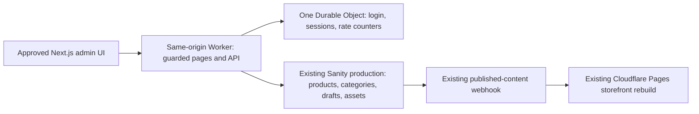

# ATELIER — single-store MVP implementation plan

2026-10-14. Direction approved by the user, subject to hard $0 additional recurring cost and compatibility/security gates; deployment is not approved. See `ADMIN_LOCAL_PROOF.md` for the local proof results and unresolved launch blockers. This replaces the earlier multi-tenant production proposal for the immediate MVP. The verification below records the planning baseline; current implementation status is recorded in the local proof.

## Recommendation

Keep the approved `apps/admin` Next.js/React interface, export its UI as static assets, and serve it alongside a small same-origin Cloudflare Worker API. Use **one SQLite-backed Durable Object** for password verification, opaque sessions and atomic login-rate counters. Use the existing Sanity project `3ahm0828` / `production` for all catalog content, native drafts and uploaded images. Preserve the existing Sanity → Cloudflare Pages webhook and public storefront.

Target additional recurring cost: **$0 within verified Free-plan allowances**. This is a feasible documented service combination, not a guarantee of actual account eligibility, remaining quota or measured runtime performance. Do not enable a paid plan automatically if an implementation gate fails.

## What was verified

- Personal Git remote remains `git@github-personal:hadar-matana/fashion-catalog-demo.git`. No GitHub writes or work-account tools were used.
- Wrangler's existing login identifies the personal email `hadarmat@gmail.com` and account `07eb45a2b5a037d1138beea811cf549b`.
- Read-only Cloudflare API lookup confirms Pages project `fashion-catalog-demo`, public hostname `fashion-catalog-demo.pages.dev`, production branch `main`. Worker account settings return `default_usage_model: standard`; this field is **not proof of a paid or free subscription**.
- Account subscriptions lookup returned HTTP 403 with the current OAuth permissions. Actual billing entitlement and remaining usage were not available; check the dashboard before approving deployment. No new token was created to obtain billing access.
- Read-only Sanity inspection confirms `production`, 12 published products, zero product drafts, five categories and ten gallery documents with product links. Existing schemas use integer agorot, stable slugs and strong references.
- Repository QA records a working `cloudflare-pages-publish` webhook excluding drafts and versions. Its current secret/filter was not printed or changed in this turn.
- Current admin uses Next.js 16.4 / React 19, client-side screens and a dynamic root layout with server `headers()`. Its mock login/provider and local-only deployment guards must be replaced intentionally after approval; it cannot simply be deployed unchanged.

## Runtime and Next.js compatibility

Static export is appropriate **only for the interface**. All authentication, authorization and Sanity mutations execute in the Worker. No write token or owner password/hash enters a static bundle. Every protected HTML path and every private API route goes through the Worker before assets are served; login and generic JS/CSS can be public because they contain no private data. Configure Worker-first routing deliberately and test direct HTML/static-path bypass attempts. Cloudflare supports this [Worker-first asset routing](https://developers.cloudflare.com/workers/static-assets/routing/worker-script/).

The UI adaptation removes the dynamic root `headers()` check, replaces `MockProvider` with a session/API adapter, and wraps the existing query-based edit route appropriately for static export. Keep paths, components, RTL styling, editor, primary-photo indicator, reorder controls, preview and toasts. Render private data only after `/api/session` succeeds. Backend protection remains mandatory even if the browser redirects to login.

Use a small TypeScript Worker with Hono routing/cookie helpers and input schemas, rather than running Next SSR for this application. One deployment can contain its assets and API; a separate `workers.dev` address avoids purchasing a domain. This does not create another public-storefront publishing pipeline or a Direct Upload Pages project.

Cloudflare/OpenNext officially supports Next.js 16, but SSR adds runtime/bundle/caching complexity and must fit the Worker Free CPU allowance. It is a valid alternative, **not necessary for these client-driven screens**. Avoid the automatic OpenNext migration command, which can create an R2 cache bucket. See [OpenNext compatibility](https://opennext.js.org/cloudflare) and [manual setup](https://opennext.js.org/cloudflare/get-started).

## One manually provisioned account

- You choose the username/password through a private local provisioning prompt. Store only the username and salted bcrypt hash in Worker secrets; use the established [bcryptjs library](https://github.com/dcodeIO/bcrypt.js), initially cost 12, with its documented 72-byte input limit enforced. No plaintext credentials in Git, Sanity, browser storage, logs or source. Actual password bytes remain exact; the forgiving Phase B password normalization is removed.
- Password verification runs in the Durable Object, **not the outer 10 ms Free Worker**. Durable Objects have a documented 30-second default CPU allowance. This allows proper password hashing rather than weakening it to meet an unsuitable CPU budget. Benchmark the chosen hash cost under `workerd` before deployment. See [Durable Object limits](https://developers.cloudflare.com/durable-objects/platform/limits/).
- Generate cryptographically random 256-bit opaque session tokens. Store their digests, expiry and CSRF state inside that one Durable Object. Browser cookie: `__Host-atelier_session`, HttpOnly, Secure, SameSite=Lax, Path=/, no Domain, eight-hour maximum. Every protected request validates it server-side; no signed-in flag from the browser is trusted. Logout deletes the session and expires the cookie. Changing credentials invalidates previous sessions through a credential-version check.
- Durable Object storage holds only small security records, not products/media. Use atomic IP and single-account login limits before expensive hashing, generic Hebrew invalid-login errors, equal verification work for unknown usernames, request size caps and cleanup of expired records. No public registration, invitations, reset emails, roles, team tables or account UI.
- Exact Origin checks, same-origin JSON requests and a session-bound CSRF header protect mutations. Login/logout are POST; never mutate through GET. Secure cookies require HTTPS outside local development. Use the documented [Hono cookie helpers](https://hono.dev/docs/helpers/cookie); do not invent encryption or JWT schemes.

This is a conventional server-side password + opaque-session pattern using proven libraries and platform storage, not a full managed-auth product. The single free Durable Object is necessary to provide durable revocation/rate counters and safe password-verification CPU without a separate database service.

## Real Sanity operations

The Worker has one fixed project/dataset and one server-only Sanity content-write secret. Provision that token only after approval; never reuse a CLI personal token as a deployed secret. Where Free-plan grants are broad, central endpoint validation and field/type allowlists prevent owners from invoking those broader capabilities. There is no arbitrary GROQ/mutation endpoint, project selector or settings endpoint.

Owner-editable fields: name, ordered images with safe image metadata, priceAgorot, category, description, sizes, colors and category name/order. Preserve product IDs, existing slugs, collections, flags, currency, sortOrder and other hidden fields unless a specifically supported owner action requires them. Validate referenced category/asset existence in this dataset, document type, IDs and array keys server-side; reject `siteSettings`, raw mutation bodies and hidden fields. Keep decimal-shekel conversion exact and generate new Hebrew-safe slugs server-side with collision protection. Use `_rev` preconditions to avoid silently overwriting concurrent Studio edits.

| Action | Content behavior |
| --- | --- |
| List | Authenticated server reads published + native drafts; merge by base ID, avoid duplicate rows and retain publication status. Existing published products stay intact. |
| Save new draft | Write `drafts.<product-id>` only; preserve incomplete drafts with the existing validation policy. |
| Publish | Validate required fields; transaction writes the base published document and removes its draft. Existing webhook rebuilds storefront. |
| Save published changes | Write only on explicit Save Changes; preserve hidden fields, respect revision conflicts and reconcile any existing Studio draft explicitly. No keystroke writes or extra Publish step. |
| Unpublish | Preserve complete editable content as a native draft and remove only the published representation in a transaction. Handle inbound references before removal. |
| Categories | Read counts across products/drafts without double counting; add, rename and reorder. Keep IDs/slugs. No category deletion in v1. |
| Preview | Current unsaved form state inside authenticated admin; no public draft URL, mutation or deploy trigger. |

**Draft privacy correction:** native `drafts.*` documents require authenticated Sanity access even in a public dataset. This is supported directly by [Sanity authentication rules](https://www.sanity.io/docs/content-lake/http-auth) and [document-path access rules](https://www.sanity.io/docs/content-lake/ids). PostgreSQL workspaces are unnecessary for private draft documents in this MVP.

There are ten existing gallery-product links. Strong references can block unpublish. Inventory these and validate a narrowly scoped transaction that preserves supported gallery references as weak links, retains their product IDs and keeps the gallery usable. Unknown inbound reference types should block removal safely. Any needed Studio schema adjustment requires a reviewed production change; do not silently sever or delete gallery content. Test on temporary content first.

## Uploads and media privacy

Send one image per authenticated Worker upload request, retaining multi-select/progress/reorder in the UI. Validate JPEG/PNG/WebP signatures, MIME, a 10 MB limit and ten images per product. Stream to the existing Sanity Assets API with the server token; rely on Sanity's image decoder and validate the returned asset metadata before accepting references. Avoid CPU-heavy re-encoding in the outer Worker; test oversized/corrupt files, bounded memory and unsupported HEIC. No browser write token, R2 bucket or paid image transformation service.

**Limitation requiring acceptance:** ordinary [Sanity dataset assets are public on its CDN](https://www.sanity.io/docs/content-lake/manage-assets), including assets uploaded for drafts. Private draft text and an authenticated preview do not make those image URLs private. Unpublish removes catalog visibility after rebuilding; previously distributed images, caches and static deployment snapshots cannot be recalled. If confidential pre-launch photos are required, this particular minimal media approach is insufficient and must be reconsidered before implementation.

Use existing upload assets without modifying/reseeding original products. Keep orphan-asset cleanup separate from owner operations; no permanent content deletion UI. Published mutations use only the existing webhook. Toasts confirm Sanity save acceptance and explain that the public site can take a few minutes to update; claim public availability only after verification.

## Cost and free-tier envelope

Official limits checked 2026-10-14. These are published plan allowances, not measured remaining allocations on this account.

| Service | Published free allowance / limitation |
| --- | --- |
| Worker + static assets | Static asset delivery/storage has no additional charge. Worker calls: 100,000/day, 10 ms CPU/request, 128 MB memory. Our small API/guard must be measured; do not assume full Next SSR fits. [Worker pricing](https://developers.cloudflare.com/workers/platform/pricing/), [limits](https://developers.cloudflare.com/workers/platform/limits/). |
| One SQLite Durable Object | Free: 100,000 requests/day, 13,000 GB-s/day, 5M rows read/day, 100,000 rows written/day and 5 GB total storage. Exceeding free allowances fails operations rather than enabling paid overages. Use no persistent timers/background work. [DO pricing](https://developers.cloudflare.com/durable-objects/platform/pricing/). |
| Existing Sanity project | Free advertised: 10,000 documents, 250,000 API requests/month, 1M API-CDN requests/month, 100 GB assets, 100 GB bandwidth/month, two webhooks. Draft and published documents consume document quota. Actual current plan/remaining usage still need dashboard verification. [Sanity pricing](https://www.sanity.io/pricing). |
| Existing Pages storefront | Free: 500 builds/month, one concurrent build; publishing shares the existing account/build allowance. [Pages limits](https://developers.cloudflare.com/pages/platform/limits/). |

One boutique is likely far below traffic/storage allowances, but attacks, uploads and repeated rebuilds can consume them. Keep the account on its existing free entitlement if confirmed, monitor usage, and stop rather than upgrade automatically. The $0 target excludes existing subscriptions, optional domains and our development/maintenance time.

If runtime/account gates fail, stop and report the exact blocker. The cheapest Cloudflare paid fallback is Workers Paid's **$5/month minimum plus usage**, subject to approval; do not enable it. A local-only real admin on the existing computer is a $0 interim alternative, with availability/device-access limitations. See [Workers paid pricing](https://developers.cloudflare.com/workers/platform/pricing/).

## Implementation and release gates after approval

1. **Local compatibility proof:** static-export the unchanged UI; add the small Worker/security object locally; test the actual `workerd` runtime, worker-first guards, bcrypt verification, CPU/bundle limits and streamed image requests. No production account creation or billable provisioning during this proof.
2. **Security and read-only integration:** replace mock login/data adapters, test expiry/logout, CSRF, rate limits, unauthenticated reads/writes, forbidden settings/fields and conflict handling. Provision owner/hash and a server-only Sanity token privately only with approval. Verify billing/remaining quota before remote provisioning/deployment.
3. **Temporary content lifecycle:** after approval for production QA, create only uniquely named test content in the existing project, upload two images, save/privately preview draft, publish, verify public appearance after rebuild, update/verify, unpublish/verify removal, and confirm native-draft recovery. Do not edit existing products or weaken unrelated references. Keep recoverable QA content unless its cleanup is explicitly approved.
4. **Release:** run browser tests on mobile/desktop plus lint/typecheck/build and security tests. Remove all mock-credential production paths. Deploy the separate secure admin only after runtime/cost/security checks and approved infrastructure/secrets changes. Keep the approved storefront and webhook untouched.

## Approval requested

Approve this single-store implementation direction: existing Next.js UI + small Cloudflare Worker + one free-tier security Durable Object + existing Sanity native drafts/assets. Accept the public draft-image URL limitation. This authorizes the next implementation step; paid upgrades remain forbidden, and production account/secret/provisioning actions must follow the approved scope and verified billing gates. No implementation has started in this planning turn.
